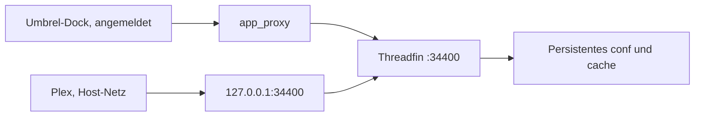

# Threadfin als eigenes Umbrel-App-Paket

Status: Umgesetzt im Repository-Root als Community-Store. Andreas hat die Spec und ein öffentliches GitHub-Repository freigegeben. Dieses Dokument bleibt die Begründung. Die Installation auf dem Umbrel-Host ist weiterhin ein separater Schritt.

Datum der Quellenprüfung: 2026-11-09.

Freigabe der Richtung: Andreas hat Threadfin als eigene Umbrel-App ohne Portainer bestätigt. Die nächste Umsetzung startet erst nach Prüfung dieser Spec.

## Ziel

Threadfin läuft als eigene App aus einem eigenen Umbrel-Community-App-Store. Die App bietet die Threadfin-Weboberfläche, nimmt M3U- und XMLTV-Quellen in dieser Oberfläche entgegen und stellt Plex einen Tuner- sowie EPG-Endpunkt bereit.

Das Paket verwendet das gepinnte Upstream-Image, speichert seine Konfiguration dauerhaft und bleibt bei den Rechten klein: kein Docker-Socket, kein `privileged`, kein Host-Netzwerk, keine Änderung von Firewall, Sysctl oder der Plex-Installation.

## Ausgangslage

- Plex ist installiert. Die gemeldete Version ist 1.43.5.11029. Dieselbe Version steht im Manifest der offiziellen Umbrel-App `plex`. Deren Compose-Datei nutzt `network_mode: host` und das Image `linuxserver/plex:1.43.5` mit Digest `sha256:8f655bad7dcbc5398a78f70a5af12600b4ed3424f901566ed1eaa6710e9e2334`.
- Der Live-TV-Tuner erreicht Port 34400 derzeit mit „connection refused“. Das passt dazu, dass auf diesem Port nichts lauscht. Dieser Lauf hat das Gerät nicht erneut gemessen.
- Im offiziellen Store `getumbrel/umbrel-apps` existiert kein Verzeichnis `threadfin` (Contents-API 404 am 2026-11-09). Eine fertige, konfigurierte Threadfin-App in den bereits eingerichteten Stores, einschließlich BigBear, wurde von den Betreibern nicht gefunden. Dieser Lauf hat den BigBear-Codeindex wegen Rate-Limit nicht vollständig neu durchsucht und das Gerät nicht abgefragt.
- Portainer ist absichtlich entfernt und bleibt entfernt.
- Ob auf dem Umbrel-Host noch alte Threadfin- oder xTeVe-Daten liegen, ist unbekannt. Die Spec behandelt sie als möglicherweise vorhanden.
- Die IPTV-Dateien unter `/workspace/iptv` liegen auf dem Coordinator-Rechner. Sie sind in diesem Workspace nicht vorhanden, werden nicht rekonstruiert und gehören nicht ins Paket.

## Vergleich

| Weg | Ergebnis |
| --- | --- |
| Eigenes Community-App-Store-Paket | Gewählt. Umbrel installiert, aktualisiert und startet die App über den unterstützten Store-Mechanismus, mit `app_proxy`, eigenem Datenverzeichnis und ohne Docker-Socket. Voraussetzung für die spätere Installation ist ein anonym per HTTPS klonbares Git-Remote. |
| Direkte Custom-App | Abgelehnt. Eine von Hand nach `app-data` kopierte oder außerhalb des Stores gestartete Compose-Datei bekommt keinen unterstützten Update-Pfad. Umbrels Deinstallation löscht das gesamte App-Datenverzeichnis. |
| Portainer | Abgelehnt. Portainer ist entfernt. Es würde den Docker-Socket brauchen, um Container zu steuern. Das widerspricht den Rechten dieses Pakets. |

## Verteilung

Ein privates Origin-Repository ist für Umbrel keine brauchbare Store-Quelle.

`umbreld` klont Community-Stores in `AppRepository.atomicClone()` mit isomorphic-git über dessen HTTP-Client: `depth: 1`, `singleBranch: true`, ohne `onAuth`. SSH-URLs scheitern an der URL-Prüfung oder am fehlenden SSH-Transport. Ein privates Origin-Repo ist anonym nicht lesbar, der Klon endet deshalb mit einem Authentifizierungsfehler. Ein Token in der URL wäre ein Geheimnis in der von Umbrel gespeicherten und in der Registry wieder ausgegebenen Store-URL. Diesen Weg gibt es nicht.

Der unterstützte Weg ist der in der Umbrel-Hilfe beschriebene Community-App-Store:

1. App Store öffnen.
2. Menü mit den drei Punkten öffnen.
3. Community App Stores wählen.
4. Eine HTTPS-URL einfügen und hinzufügen.

Umbrel klont dabei den Default-Branch flach. Die Dokumentation zeigt diesen Ablauf mit einem öffentlichen GitHub-Repository. Der Code akzeptiert jede HTTPS-Git-URL, die isomorphic-git anonym klonen kann. Diese Spec gibt kein Remote frei und veröffentlicht nichts. Ein öffentliches GitHub-Repository entsteht nur nach einer späteren, ausdrücklichen Freigabe. Bis dahin bleibt das Paket in diesem Workspace und ist über den Umbrel-Store-Updater nicht installierbar.

## Paketform

Store-Metadaten:

- Datei `umbrel-app-store.yml`
- `id`: `oit`
- `name`: `OIT`

App:

- Verzeichnis und Manifest-`id`: `oit-threadfin`
- Die ID beginnt mit der Store-ID. Umbrel filtert Community-Apps mit `app.id.startsWith(meta.id)` und löst das Template über diese ID auf. Verzeichnisname und `id` sind gleich.
- `manifestVersion`: `1`
- `category`: `media`
- `name`: `Threadfin`
- `version`: `0.1.0` für das erste Paket. Das ist die Umbrel-Paketversion. Die Threadfin-Version `1.2.37` und der Image-Digest stehen in `releaseNotes` und in `docker-compose.yml`. Die Paketversion zählt Umbrel-Änderungen und wird nicht als Upstream-Release gelesen.
- `port`: `34400`
- `path`: `/web`
- `dependencies`: `[]`
- `storage.dataRoot`: `data`
- `permissions` und `folderAccess` fehlen. Die App fordert keinen GPU-Zugriff und kein Downloads-Verzeichnis an.
- `defaultUsername` und `defaultPassword` bleiben leer. Es gibt kein `deterministicPassword`.
- `gallery`: `[]`
- `developer`: `Threadfin`
- `website`, `repo` und `support` zeigen auf das öffentliche Upstream-Projekt `https://github.com/Threadfin/Threadfin` beziehungsweise dessen Issue-Tracker.
- `submission` bleibt weg, bis eine echte Einreichungs-URL existiert.
- `icon.svg` liegt im App-Verzeichnis. Das Feld `icon` wird beim Veröffentlichen auf die absolute HTTPS-URL dieser Datei im dann freigegebenen Remote gesetzt. Umbrel schreibt Icons von Community-Stores nicht auf die offizielle Gallery um; ein fehlendes `icon` zeigt sonst auf `getumbrel.github.io`.

Hooks laufen im aktuellen `app-script`, sobald `app-data/<id>/hooks/<name>` ausführbar ist. Dafür ist `manifestVersion: 1.1` nicht erforderlich. Ein Hook-Fehler bricht den Start nicht ab, weil Umbrel den Exit-Code schluckt. Der Hook ist deshalb klein, und der Gerätetest prüft danach den Besitzer der Daten.

## Architektur

Ein Compose-Projekt mit zwei Diensten:

- `server` führt das gepinnte Threadfin-Image aus.
- `app_proxy` ist der von Umbrel beigesteuerte Proxy. `APP_HOST` ist `oit-threadfin_server_1`, `APP_PORT` ist `34400`.

Die Weboberfläche wird aus dem Umbrel-Dock über den Proxy geöffnet. Der Proxy verlangt die Umbrel-Anmeldung. `PROXY_AUTH_ADD` bleibt auf dem Umbrel-Standard, und `PROXY_AUTH_WHITELIST` wird nicht gesetzt. Plex benutzt diesen Proxy nicht. Ein anonymer Aufruf dort erhält die Umbrel-Anmeldung statt einer HDHomeRun-Antwort.

Plex läuft in der offiziellen App im Host-Netz. Threadfin veröffentlicht deshalb nur `127.0.0.1:34400` auf dem Host und bleibt selbst im normalen Compose-Netz. Plex erreicht den Tuner unter `http://127.0.0.1:34400`, weil beide Seiten denselben Host-Loopback sehen. Im Container lauscht Threadfin auf `0.0.0.0:34400`, damit Proxy und veröffentlichter Host-Port denselben Prozess erreichen. Die Beschränkung auf den Loopback gilt auf der Host-Seite.

SSDP bleibt aus. Multicast aus dem Bridge-Netz ist nicht der Erkennungsweg. In Plex wird der Tuner manuell eingetragen. Der EPG-URL ist `http://127.0.0.1:34400/xmltv/threadfin.xml`.

Diese Loopback-Annahme gilt, solange der installierte Plex-Container das Host-Netz der offiziellen Compose-Datei behält. Die Umsetzung ändert Plex nicht. Vor der Tuner-Einrichtung prüft eine reine Leseoperation auf dem Gerät den Netzwerkmodus. Weicht er ab, wird diese Spec überarbeitet. Der Port wird dann nicht auf `0.0.0.0` gelegt und die Plex-Compose-Datei nicht editiert.

Gegen den umbreld-Stand vom 2026-11-09 bleibt die Bindung an `127.0.0.1:34400`. Das App-Gateway liest `APP_HOST` und verbindet sich mit der Container-IP im Netz `umbrel_main_network`, nicht mit dem veröffentlichten Host-Port. Plex im Host-Netz benutzt dagegen genau `127.0.0.1`. Eine Whitelist am Gateway würde dieselben Pfade auch über die LAN-Weiterleitung öffnen. Der veröffentlichte Port bleibt deshalb auf dem Loopback und `PROXY_AUTH_WHITELIST` bleibt leer.

Umbrel versucht zusätzlich, selbst `127.0.0.1` und den Manifest-Port zu belegen. Liegt der Port schon bei Docker, schreibt umbreld den Fehler und lässt den LAN-Weg zur angemeldeten Oberfläche bestehen. Aufrufe von `127.0.0.1:34400` auf dem Host gehen dann direkt an Threadfin. `/web/` schützt dort die Threadfin-Anmeldung. Die Maschinenpfade bleiben auf diesem Loopback ohne Zugangsdaten.

## Image und Architekturen

Image:

`fyb3roptik/threadfin:1.2.37@sha256:96122ab220e14b881cbd40d7f8c7b022e1f9c6ecfe05aca2ab801e0321dc0d61`

Geprüft am 2026-11-09 über die Docker-Hub-Tag-API:

- GitHub Release `latest` ist `1.2.37`, veröffentlicht 2025-09-11.
- Der Tag `1.2.37` ist ein OCI-Index mit `linux/amd64`, `linux/arm64` und `linux/arm/v7`. Weitere `unknown`-Einträge sind Attestations, keine CPU-Architekturen.
- Die Tags `1.2.38` und `1.2.39` existieren auf Docker Hub nicht.
- `latest` wurde am 2025-10-20 gepusht, ist nur `linux/amd64` und hat keinen neueren GitHub-Release. `latest` und die NVIDIA-Variante werden nicht verwendet.
- Der Index-Digest wird gepinnt, damit Umbrel die zum Gerät passende Architektur aus demselben Index zieht.

Das Dockerfile von Tag `1.2.37` enthält kein `USER` und kein `useradd`. Der Entry-Point startet die Binary direkt. `PUID` und `PGID` aus Compose-Beispielen liest dieser Entry-Point nicht; das Paket setzt sie nicht. `THREADFIN_BRANCH` wird nicht gesetzt, damit kein In-App-Update suggeriert wird.

Der Prozess läuft als numerischer User `31337:31337`. Das entspricht `THREADFIN_UID` und `THREADFIN_GID` im Image. Ein stiller Fallback auf Root ist nicht vorgesehen. Startet der gepinnte Stand so nicht, stoppt die Umsetzung zur Überarbeitung dieser Spec.

Im Image sind `ffmpeg`, `vlc` und `jellyfin-ffmpeg7` enthalten. Die VLC-Binary ist upstream so verändert, dass sie auch als Root startet. Der Nicht-Root-User bleibt trotzdem die Vorgabe.

## Persistente Daten

Umbrel legt bei der Installation `app-data/oit-threadfin` an und kopiert das Template dorthin. Updates kopieren nur `docker-compose.yml`, `*.template`, `exports.sh`, `torrc`, `hooks` und danach `umbrel-app.yml`. Dateien unter `data/` bleiben dabei liegen. Die Deinstallation führt `rm -rf` auf dem gesamten App-Datenverzeichnis aus.

Das Template enthält keine `settings.json`, keine Playlist und kein Beispiel-XMLTV. Ein leerer Erststart ist der normale Weg und bedeutet nicht, dass ältere Daten verschwunden sind.

Verzeichnisse:

| Host, unter `app-data/oit-threadfin/data` | Container | Inhalt |
| --- | --- | --- |
| `conf` | `/home/threadfin/conf` | `settings.json`, Zuordnungen, Zugangsdaten der Quellen, erzeugtes `threadfin.xml` und `threadfin.m3u` |
| `cache` | `/home/threadfin/cache` | Logos und Cache |
| tmpfs | `/tmp` | Puffer und temporäre Dateien, einschließlich `/tmp/threadfin` |
| tmpfs | `/var/log` und `/run` | Laufzeitdateien, nur wenn `read_only` aktiv ist |

Der Hook `hooks/pre-start` läuft vor `compose up`. Ist `data`, `conf` oder `cache` ein Symlink, beendet er sich mit einem Fehler und ändert nichts. Umbrel schluckt diesen Exit-Code und startet danach trotzdem. Ein Symlink ist deshalb ein Abbruch im Gerätetest, bevor die App gestartet wird. Sonst legt der Hook die beiden Verzeichnisse an, setzt den Besitzer auf `31337:31337` und das Verzeichnisrecht auf `0750`. Er löscht nichts und fasst keinen Pfad außerhalb von `app-data/oit-threadfin/data` an. Dateien, die der Betreiber vorher in `conf` gelegt hat, bleiben erhalten.

Vor der ersten Installation auf dem Gerät prüft der Betreiber, dass `app-data/oit-threadfin` noch nicht existiert. Existiert es, wird nicht installiert und nicht deinstalliert, sondern zuerst nachgesehen.

Eine spätere Übernahme alter Daten ist ein eigener, manueller Schritt und nur dann, wenn der Betreiber das Quellverzeichnis auf dem Umbrel-Host selbst identifiziert hat. Die App wird vor dem ersten Assistenten gestoppt, der Inhalt wird nach `data/conf` kopiert, und der Hook setzt beim nächsten Start den Besitzer. Das Paket sucht nicht danach und mountet keine fremden Host-Pfade. Die Coordinator-Dateien unter `/workspace/iptv` sind keine Quelle.

In Threadfin gespeicherte M3U-URLs, XMLTV-URLs und Zugangsdaten bleiben in `conf` auf dem Host. Sie werden nicht ins Git-Repository übernommen.

## Ports und Authentifizierung

Host-Port in Compose: `127.0.0.1:34400:34400/tcp`. Es wird kein UDP veröffentlicht. Firewall und Plex bleiben unverändert.

| Aufruf | Schutz | Verwendung |
| --- | --- | --- |
| Umbrel-Dock nach `/web` | Umbrel-Proxy-Anmeldung und danach Threadfin-WEB-Login | Bedienung |
| `http://127.0.0.1:34400/web/` | Threadfin-WEB-Login | Direkter Loopback-Zugriff auf die Oberfläche |
| `/discover.json`, `/lineup_status.json`, `/device.xml`, `/capability` | keine Zugangsdaten | HDHomeRun-Erkennung durch Plex |
| `/lineup.json` | keine PMS-Authentifizierung | Senderliste für Plex |
| `/stream/` | keine Web-Anmeldung | Von Plex abgerufene Streams |
| `/xmltv/threadfin.xml` | keine XML-Authentifizierung | EPG in Plex |
| `/m3u/threadfin.m3u` | keine M3U-Authentifizierung | optionale Playlist, von Plex nicht als Tuner benötigt |
| `/api/` | Threadfin-API-Authentifizierung | Verwaltung |

WEB- und API-Authentifizierung werden im ersten Assistenten eingeschaltet, bevor eine Quellen-URL gespeichert wird. PMS-, M3U- und XML-Authentifizierung bleiben aus. Plex kann die Maschinen-URLs dann ohne eingebettete Zugangsdaten verwenden. Die offenen Maschinenpfade sind nur über `127.0.0.1` erreichbar, also für Prozesse auf dem Host, einschließlich des host-vernetzten Plex.

Der Puffer steht auf dem Threadfin-Puffer, nicht auf direkter Weiterleitung. Plex erhält dadurch die Upstream-Stream-URL nicht. Das ist eine Einstellung in der Oberfläche, kein Wert im Repository. Das In-App-Update von Threadfin bleibt aus; Updates laufen über den Image-Digest.

Upstream verlangt für Plex Live-TV einen DVR-fähigen Server, praktisch Plex Pass, und einen passenden Client. Die vorhandene Tuner-Eintragung spricht dafür. Dieser Lauf hat den Plex-Account nicht geprüft.

## Rechte

Das Compose-Ziel für `server`:

- Image exakt wie oben gepinnt
- `user: "31337:31337"`
- `init: true`
- `restart: on-failure`
- `read_only: true`
- `tmpfs` für `/tmp`, `/var/log` und `/run`
- `security_opt: ["no-new-privileges:true"]`
- `cap_drop: ["ALL"]`
- kein `privileged`, kein `cap_add`, kein `network_mode: host`, kein Device, kein Docker-Socket, kein fremdes Volume
- Umgebungsvariablen nur `THREADFIN_PORT=34400`, `THREADFIN_BIND_IP_ADDRESS=0.0.0.0` und `THREADFIN_DEBUG=0`

Startet das gepinnte Image mit einem dieser beiden Schlüssel nicht, entfällt nur der Schlüssel, der den Start verhindert. `read_only` und `cap_drop` werden getrennt geprüft. Der Grund steht in den Release Notes. Entfällt `cap_drop`, bleibt das normale Docker-Capability-Set ohne zusätzliche Capabilities. Root, `privileged`, Host-Netz, Socket und `0.0.0.0:34400` sind keine Ausweichlösung.

## Installation, Update, Rollback

Installation, später und nur nach Freigabe des Remotes und dieser Spec:

1. Prüfen, dass `app-data/oit-threadfin` fehlt.
2. Den anonymen HTTPS-Store im Umbrel-UI hinzufügen.
3. `oit-threadfin` installieren.
4. Die Oberfläche über das Umbrel-Dock öffnen, den Threadfin-Benutzer anlegen und WEB- sowie API-Authentifizierung aktivieren.
5. M3U und XMLTV in der Oberfläche eintragen. Die Werte kommen vom Betreiber, nicht aus diesem Repository.
6. In Plex den Tuner manuell auf `http://127.0.0.1:34400` setzen und als EPG `http://127.0.0.1:34400/xmltv/threadfin.xml` eintragen.
7. Puffer und deaktiviertes In-App-Update prüfen.

Update: Ein neuer Commit auf dem Default-Branch des freigegebenen Remotes wird von Umbrel flach geklont. Die erste Manifest-Version ist `0.1.0`. Weitere Pakete erhöhen sie semver-konform, zum Beispiel auf `0.1.1`. Die Umsetzung prüft auf der Ziel-umbrelOS, dass die Oberfläche genau diese neuere Version als Update anbietet, bevor ein zweites Paket erscheint. Weicht der Vergleich ab, gibt es kein zweites Paket, bis diese Spec angepasst ist. Digest und Release Notes nennen weiterhin Threadfin `1.2.37` oder den jeweils gepinnten Stand. Updates lassen `data/conf` und `data/cache` liegen.

Rollback der App-Daten über Deinstallation ist ausgeschlossen, weil dabei das Datenverzeichnis gelöscht wird. Rollback des Images ist ein neues Paket mit höherer Manifest-Version und dem vorher notierten Digest. Vor dem ersten bestätigten Versionsvergleich ist der gerätebezogene Zwischenweg: App im UI stoppen, nur die Image-Zeile der installierten `docker-compose.yml` auf den vorher notierten Digest setzen und wieder starten. Der nächste Store-Update überschreibt diese Datei, deshalb trägt der zugehörige Store-Commit denselben Digest.

Der vorherige Digest wird in den Release Notes des jeweiligen Pakets festgehalten. Für das erste Paket gibt es noch keinen vorherigen Paket-Digest.

## Tests

In diesem Cloud-Lauf geprüft:

- Umbrel-Quellstand von `app-repository.ts`, `schema.ts`, `apps.ts` und `legacy-compat/app-script` auf dem Default-Branch.
- Offizielle Dateien `plex/umbrel-app.yml` und `plex/docker-compose.yml`.
- Community-Store-Vorlage und die Umbrel-Hilfe zum Hinzufügen eines Stores.
- Threadfin-Release-API, Dockerfile von Tag `1.2.37` und die Docker-Hub-Tag-API.
- Contents-API: `getumbrel/umbrel-apps/threadfin` liefert 404.

In diesem Cloud-Lauf nicht geprüft, weil hier kein Umbrel, kein Plex und keine Quell-URLs vorhanden sind:

- Installation, Update und Rollback auf dem Gerät.
- Ob Plex dort tatsächlich noch im Host-Netz läuft.
- Ob Port 34400 weiterhin geschlossen ist.
- Tuner-Erkennung, EPG-Zuordnung und Wiedergabe.
- Ob alte Threadfin-Daten auf dem Host liegen.
- Der Umbrel-Proxy und der Threadfin-Login im Browser.

Cloud-Prüfungen der späteren Umsetzung, weiterhin ohne Gerät und ohne echte Playlists:

- YAML ist parsebar, Store-ID und App-ID passen zusammen.
- Compose enthält den exakten Digest, Loopback-Port, User `31337:31337` und keinen der verbotenen Schlüssel.
- Das Repository enthält keine URL mit Zugangsdaten, kein M3U und kein XMLTV.
- Der Hook lehnt Symlinks ab und löscht in einem Fixture keine vorhandene Datei.
- Ein Lesezugriff auf die Registry zeigt für den gepinnten Index `amd64` und `arm64`.

Geräteprüfungen bleiben eine eigene Freigabe. Sie umfassen den Netzwerkmodus von Plex, den Besitzer von `data/conf`, die Bind-Adresse `127.0.0.1:34400`, die Umbrel-Anmeldung vor der Oberfläche, den Threadfin-Login auf dem Loopback, eine anonyme HDHomeRun-Antwort von `127.0.0.1`, den manuellen Plex-Tuner, das Laden des EPG nach dem Eintragen der eigenen Quelle und den Erhalt von `conf` nach Neustart und Update.

## Grenze dieser Spec

Die Store-Dateien liegen im Repository-Root. Der Coordinator spiegelt sie nach `github.com/andreasolbricht/umbrel-oit-store`. Installation auf dem Umbrel-Host, Plex-Änderung und jede Änderung an Firewall oder Host-Netz bleiben getrennt und sind mit diesem Stand nicht ausgeführt.
